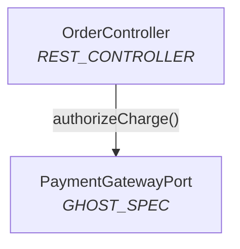

import { Aside } from '@astrojs/starlight/components';

ArcDrift stores your project's architectural rules, planned **Ghost Components**, and saved layout coordinates in a single file at the root of your repository: **`architecture.arc.mmd`**.

Because `architecture.arc.mmd` uses standard **Mermaid flowchart syntax** with `%% @arc:` directive comments, it renders as a visual diagram directly on GitHub, GitLab, and Notion — while giving ArcDrift machine-checkable rules for your IDE and CI pipeline.

---

## Example `architecture.arc.mmd`



---

## Adding Boundary Rules (`%% @arc:rule`)

You can add a boundary rule either by clicking **`+ Boundary Rule`** in the ArcDrift toolbar or by adding a `%% @arc:rule` line to `architecture.arc.mmd`:

```text
%% @arc:rule id="<rule-id>" name="<display-name>" from="<glob>" to="<glob>" policy="FORBIDDEN|ALLOWED_ONLY|MUST_DEPEND_VIA_INTERFACE" rationale="<why this rule exists>"
```

### Supported Rule Policies

| Policy | Meaning | Typical Use Case |
| :--- | :--- | :--- |
| **`FORBIDDEN`** | Components matching `from` must never depend on components matching `to`. | Preventing `@RestController` classes (`*.controller.*`) from bypassing services to call `@Repository` classes (`*.repository.*` or `*.repo.*`). |
| **`ALLOWED_ONLY`** | Components matching `from` may *only* depend on components matching `to` (or within their own package). | Keeping a pure domain model (`*.domain.*`) free of infrastructure or framework imports. |
| **`MUST_DEPEND_VIA_INTERFACE`** | Components matching `from` cannot depend on concrete classes in `to`; they must depend on an `INTERFACE` port instead. | Enforcing Hexagonal / Ports-and-Adapters boundaries between application services and external adapters. |

---

## Planning Ahead with Ghost Components (`GHOST_SPEC`)

When designing a new feature, you often want to sketch a new service or port interface on the architecture canvas *before* creating source files:

1. Click **`+ Ghost Component`** in the ArcDrift toolbar.
2. ArcDrift adds a dashed **`GHOST_SPEC`** card to the canvas and saves it in `architecture.arc.mmd` without cluttering your `src/` directory with unimplemented code.
3. When you are ready to implement it, click **`Handoff to Agent`** (or create the class yourself). Once the real class or interface exists in code, ArcDrift automatically replaces the Ghost Spec placeholder with the live component.

<Aside type="tip" title="Which .arc.mmd File Does ArcDrift Open?">
  If your repository also stores CI baseline snapshots (such as `baseline.arc.mmd`), ArcDrift always prioritizes **`architecture.arc.mmd`** as your primary specification file when saving rules or clicking `.arc.mmd` file chips.
</Aside>
